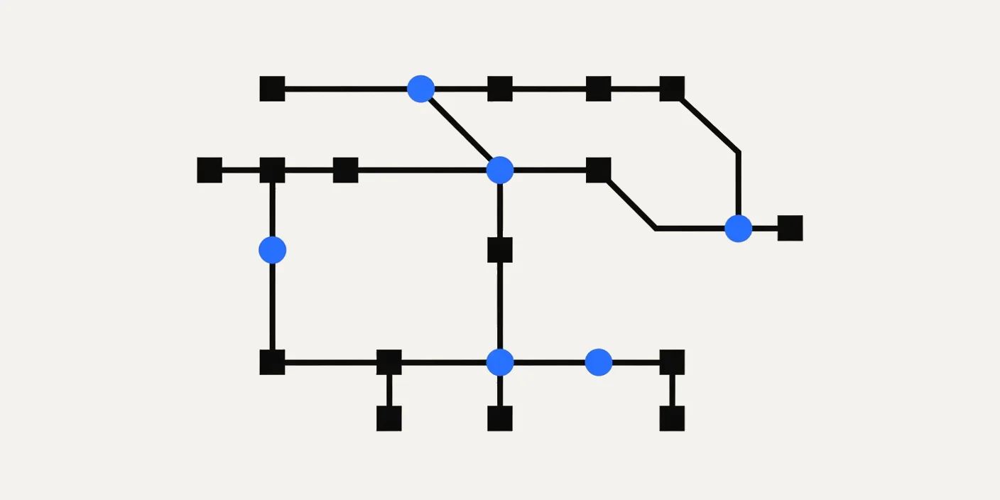

<p align="center">
  <picture>
    <source media="(prefers-color-scheme: dark)" srcset="docs/brand/heliopause-wordmark-dark.svg">
    
  </picture>
  <br>
  <sub>by Coco Research</sub>
</p>

<p align="center">
  Heliopause organizes your AI tools like a small company, on your own machine.<br>
  See which role is working, what needs you, and what broke.
</p>

<p align="center">
  
  <a href="LICENSE"></a>
  
  
</p>

---

### Install with your agent

On a managed computer? Check its rules before you install, and read INSTALL.md first.

Paste this into Claude Code, Codex, or any coding agent:

```text
Install Heliopause v0.7.1 from https://github.com/coco-research/heliopause by following its INSTALL.md at the v0.7.1 tag.
```

[INSTALL.md](INSTALL.md) tells your agent to show you each step and wait for your yes before it changes anything outside `~/atlas-lab`.

<picture><source media="(prefers-color-scheme: dark)" srcset="docs/readme/hero-dark.webp"></picture>

<sub>A sample company, not real data. This is an early preview: expect rough edges.</sub>

## What it is

Heliopause by Coco Research gives your AI tools a Lead and roles, like a small company, and one page that shows what they're doing. It runs on your machine and serves `http://127.0.0.1:4300`.

- **Now:** one sentence on what needs you, then a map of your agents. A pulse travels a link when something moves.
- **Agents:** each agent as working, idle, blocked, or needs you, with its latest line.
- **Work:** open pull requests and CI results, shown as problems, plus alerts with a Done button.
- **A sample company** to look at before you point it at your own folders.

## What it isn't

- **Not a cloud service.** There's no account, no telemetry, and no remote sync. The server binds `127.0.0.1` only.
- **Not finished.** This is an early preview. The command is still called `atlas` in this version, and the Python package folder is `atlas/`.

## Quick start

(`atlas` is Heliopause's internal module name.)

You need `git` and `python3` 3.9 or newer. The optional plugin step also needs the Claude Code `claude` command on your PATH.

```bash
git clone --branch v0.7.1 --depth 1 https://github.com/coco-research/heliopause ~/Heliopause
cd ~/Heliopause
python3 -B -m atlas adopt --scan
python3 -B -m atlas adopt --apply --lead-name Ada
python3 -B -m atlas plugin install --host claude
python3 -B -m atlas up
```

`adopt --scan` prints what it found and writes one report file. It reads chat file names, sizes and times only; it never opens a chat. `adopt --apply` prints its plan first and waits for your yes before it writes anything: run it once to see the plan, then again with `--yes` when you agree.

Then open <http://127.0.0.1:4300>. Check the setup with:

```bash
python3 -B -m atlas doctor
```

`hooks: not connected` and `memory: not included in this build` are expected in this version. The plugin carries the hook.

On a managed computer, use option 1 in [INSTALL.md](INSTALL.md) (download the v0.7.1 release and check its sha256).

## What it reads and writes

Everything below happens only when you run the command. The table says how to undo each one.

Three steps write inside `~/atlas-lab` without asking: the scan report, the optional profile step, and `atlas up`. Everything outside `~/atlas-lab` waits for your yes.

**What it reads**
- The folders you point it at.
- Your AI tools' hook and settings files, to list your hooks: `~/.claude/settings.json`, `~/.claude/settings.local.json`, `~/.cursor/hooks.json`, `~/.codex/hooks.json` and `~/.grok/hooks/*.json`. From `~/.claude.json`, `~/.cursor/mcp.json` and your other tools' MCP files it reads only the server names.
- `GET /api/hooks` and `atlas hooks-list` only read hook metadata from the home directory (tool, file, event, a short name, ours) and write nothing. The page's local routes include `GET /api/hooks`, and, in lab mode, `GET /api/roles`.
- When setup looks for your tools: each supported tool's command on your PATH, its app in `/Applications`, and its settings folder or file in your home folder (`~/.claude`, `~/.cursor`, `~/.codex`, `~/.grok`, `~/.gemini`, `~/.config/opencode`, `~/.aider.conf.yml`, `~/.copilot`). It only checks that they exist. It doesn't open them.
- The names and sizes of `~/.claude/CLAUDE.md`, the files in `~/.cursor/rules/`, and any `CLAUDE.md` or `AGENTS.md` in your project folders. It does not read what is in them.
- If you turn GitHub on in `~/atlas-lab/atlas.json` (`"github": {"enabled": true}` plus your `org` and `repos`), it reads their open pull requests and checks through your own `gh` command. It only reads.
- Your Claude Code chat transcripts in `~/.claude/projects/`: only their folder names, file sizes and dates. It never opens them, and no setting changes that.
- It never reads key files (`~/keys`), `~/.secrets` or any `.env`.

**What it writes, and how to undo it**

| Command | Writes | Undo |
|---|---|---|
| `atlas adopt --scan` | One report: `~/atlas-lab/.atlas/adopt-scan.json`. It creates `~/atlas-lab` if it isn't there. | Delete that file. |
| `atlas adopt --apply` | In `~/atlas-lab`: `CLAUDE.md`, `START-HERE.md`, `BUS.md`, `board.md`, `feed.md`, `atlas.json`, `.cursor/rules/atlas.mdc`, `bin/`, `nodes/`, empty work folders, and a backup and undo list in `~/atlas-lab/.atlas/`. Outside the lab it writes `~/.atlas/lab`, one line naming your lab. All of this happens only after it shows its plan and you run it again with `--yes`. | `atlas adopt --uninstall`. That keeps the scan report, the backup and any file you edited, so delete `~/atlas-lab` to remove those. |
| `atlas plugin install --host claude` | Before it asks: the plugin files in `~/Heliopause/marketplace`. After your yes: `~/.atlas/plugin-hosts`. It then runs `claude plugin marketplace add` and `claude plugin install`, and Claude Code records the plugin in `~/.claude/settings.json` and `~/.claude/plugins/`. | `atlas plugin uninstall --host claude` |
| `atlas up` | Inside `~/atlas-lab`: on the first run only, a test job in `queue/done/echo-hello.md` and two lines in `board.md`. Its state (access token, alerts, notification log) goes in `~/atlas-lab/.atlas/`. While it runs, it also writes these, all inside `~/atlas-lab`: your role picks go to `~/atlas-lab/atlas.json`; Approve, Decline and marking a job (and a tool reporting a job's result) write message, lease and lock files (all mode 0600) in `~/atlas-lab/.heliopause/inbox/<role>/` and `~/atlas-lab/.heliopause/done/<role>/`; the setup check writes one probe file in `~/atlas-lab/.heliopause/inbox/factory/` and then deletes it. | Stop it with Ctrl-C, then delete `~/atlas-lab`. |
| `atlas init` | A new `~/atlas-lab` (or the folder you give `--dir`) with the lab files, after it asks. | `atlas uninstall`. |
| `atlas hooks` | Two hooks in `~/.claude/settings.json` (SessionStart and UserPromptSubmit), after it shows the change and you say yes. It also writes a backup in `~/atlas-lab/backups/` and two hook scripts in `~/atlas-lab/bin/`. You don't need this in 0.7, because the plugin carries the hook. Grok also runs hooks from this file; in a Grok session Heliopause's hooks only log. | `atlas uninstall`. It also deletes `~/atlas-lab`. |
| `atlas uninstall` | Takes its hooks out of `~/.claude/settings.json`, moves `~/atlas-lab/decisions` to `~/atlas-lab.decisions-kept`, and deletes `~/atlas-lab`. It asks first. | None. To keep nothing, delete `~/atlas-lab.decisions-kept`. |
| `atlas adopt --mark FOLDER` | `~/atlas-lab/projects/<name>/START-HERE.md`, plus a line in `~/atlas-lab/atlas.json`. | `atlas adopt --unmark FOLDER` |
| `atlas brief --edit --role NAME` | `~/atlas-lab/briefs/NAME.md`. Then it opens your editor. | `atlas brief --reset --role NAME` |
| `atlas export` | `atlas.lock` in the folder you run it from (or the path you give `--out`). | Delete that file. |

**Handing off work.** `python3 -m harness run --name claude|cursor` and `python3 -m atlas.dispatch` start an AI tool you already have, with a task, only when you run them. That tool sends the work to its own service.

Apart from the `gh` lookups above and the AI tools it starts for you, Heliopause makes no network calls. Its page listens only on `127.0.0.1`.

## Privacy

- Local only. The page is served on `127.0.0.1:4300`, and Heliopause sends nothing of its own anywhere.
- If you turn GitHub on in `~/atlas-lab/atlas.json`, it asks GitHub for the open pull requests and checks of the repos listed there, read-only, through your own `gh` command.
- The server rejects other host headers.
- No telemetry, no remote sync, no analytics.
- It never reads key files, `~/.secrets`, or any `.env`.
- Token-shaped strings are redacted before any text reaches the page.
- A few optional commands can hand a task to an agent tool you already have, only when you run them.

## Verifying releases

Release zips come with a signed manifest. The signing key fingerprint is `SHA256:BhX36VYf09D8ozPzKQ76hAQEQjJ75y6pR+O4UNkeQCw` (ED25519). Compare it with the release notes.

Before you unzip, check the download is ours. You need OpenSSH 8.1 or later. Recent macOS versions include it; check with `ssh -V`. In the folder with the four files, run:

```
shasum -a 256 -c --status heliopause-v0.7.1.zip.sha256 &&
echo 'atlas-release namespaces="atlas-release" ssh-ed25519 AAAAC3NzaC1lZDI1NTE5AAAAIArkj2zdOYSu0g8yfYV7Vru1PD1bUM/CKUUZ+QX2bXEV' > heliopause-allowed-signers &&
ssh-keygen -Y verify -f heliopause-allowed-signers -I atlas-release -n atlas-release -s heliopause-v0.7.1.manifest.sig < heliopause-v0.7.1.manifest > /dev/null &&
grep -qF "\"sha256\": \"$(shasum -a 256 heliopause-v0.7.1.zip | cut -c1-64)\"" heliopause-v0.7.1.manifest &&
grep -qF '"filename": "heliopause-v0.7.1.zip"' heliopause-v0.7.1.manifest &&
echo "Verified: heliopause-v0.7.1.zip is the signed v0.7.1 release." ||
{ echo "NOT VERIFIED: do not unzip. See SECURITY.md." >&2; false; }
```

It should print `Verified: heliopause-v0.7.1.zip is the signed v0.7.1 release.` If it doesn't, don't unzip, and see SECURITY.md.

Signing, the trust anchor, and emergency revocation are in [SECURITY.md](SECURITY.md).

## Uninstall

```bash
cd ~/Heliopause && python3 -B -m atlas plugin uninstall --host claude
cd ~/Heliopause && python3 -B -m atlas adopt --uninstall
```

Then delete the three folders it made: `~/Heliopause`, `~/atlas-lab`, and `~/.atlas`. `~/atlas-lab` may hold your own work, so move anything you want to keep out of it first. The uninstall commands don't touch your files anywhere else.

## Licence

MIT. Copyright Coco Research.

Also from Coco Research: [Coco SI](https://github.com/coco-research/coco)
